# Zen Fluent

Traduction de [README.md](README.md).

Donnez à [Zen Browser](https://zen-browser.app) l'apparence d'une application
Windows 11 : fonds Mica, Mica Alt et Acrylic, contrôles WinUI 3, icônes et
animations Fluent, ou l'apparence de Microsoft Edge. Chaque détail se change
depuis les réglages, rien à modifier à la main.

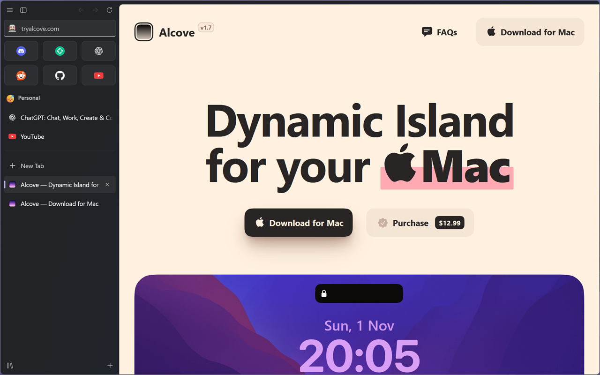

<p align="center">
  <a href="#installation">Installation</a> ·
  <a href="#galerie">Galerie</a> ·
  <a href="#zen-fluent-enhanced">Enhanced</a> ·
  <a href="docs/fr/settings/README.md">Réglages</a> ·
  <a href="docs/fr/compatibility.md">Mods compatibles</a> ·
  <a href="CHANGELOG.md">Journal des modifications</a> ·
  <a href="README.md">English</a>
</p>

## Ce que vous obtenez

- **Le matériau de Windows 11** derrière la barre latérale et les barres
  d'outils : Mica, Mica Alt ou Acrylic, teinté de la couleur de votre espace.
- **Des contrôles WinUI 3 partout** : onglets, Essentials, barre d'adresse,
  menus, panneaux, boîtes de dialogue, notifications, la Bibliothèque, la vue
  scindée, Glance et les pages de Zen.
- **Deux styles** : Windows 11 (WinUI) ou Microsoft Edge (Fluent 2).
- **Vos couleurs** : la couleur d'accentuation de Windows, sept autres ou la
  vôtre, les modes clair et sombre, les coins et la densité que vous aimez.
- **Plus d'une centaine de réglages** rangés en groupes repliables. Chaque
  partie (barre latérale, barre d'adresse, menus…) peut aussi garder
  l'apparence de Zen.
- **Accessible** : les thèmes de contraste de Windows et les animations
  réduites sont respectés.

Zen Fluent est en CSS pur. **Zen Fluent Enhanced**, un second mod facultatif,
ajoute les fonctions que le CSS ne peut pas faire (voir
[plus bas](#zen-fluent-enhanced)).

## Galerie

| Mode clair                                          | Style Microsoft Edge                             |
| --------------------------------------------------- | ------------------------------------------------ |
| 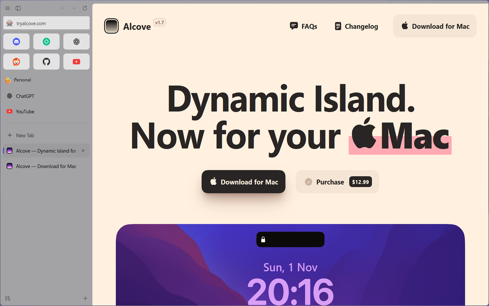 | 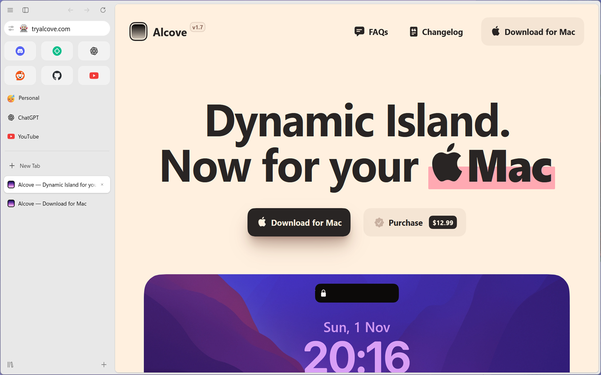              |
| **Acrylic, accent orange**                          | **Coins de Zen, accent violet**                  |
|      | 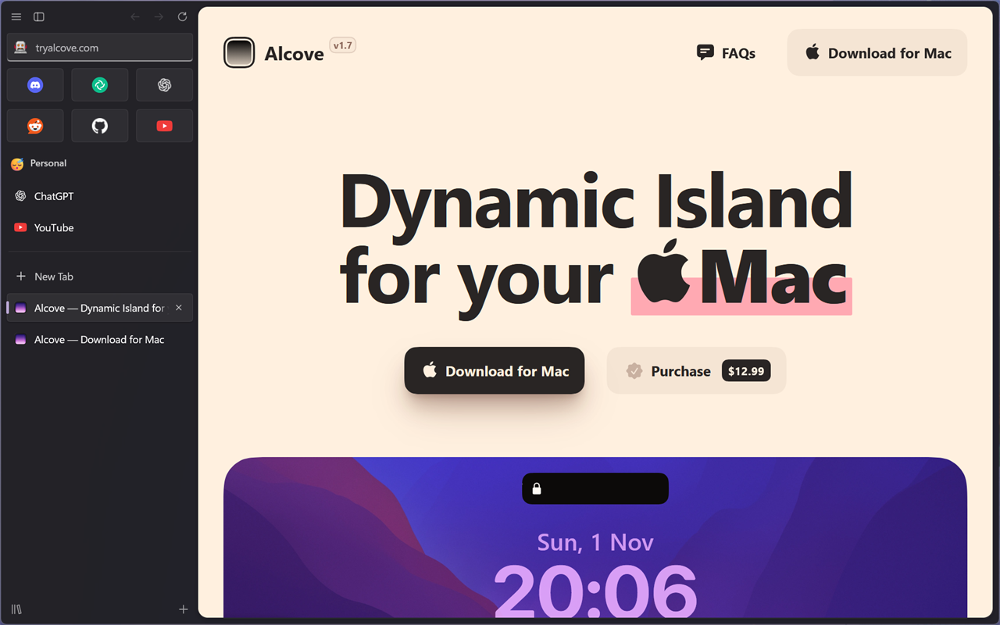 |

<details>
<summary>Plus de captures</summary>

| Mica Alt                                                    | Barre d'adresse flottante                  |
| ----------------------------------------------------------- | ------------------------------------------ |
| 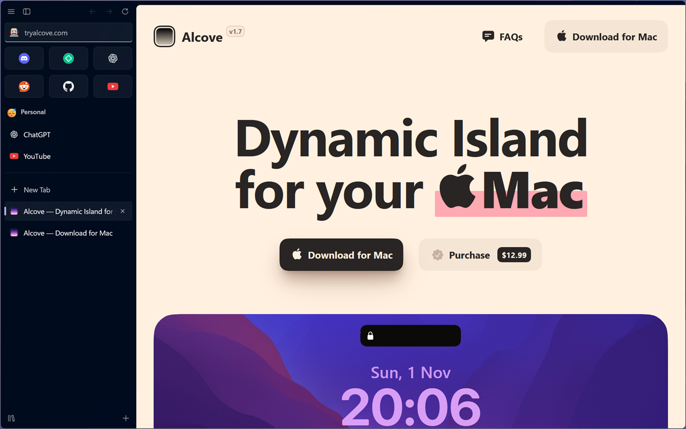                  | 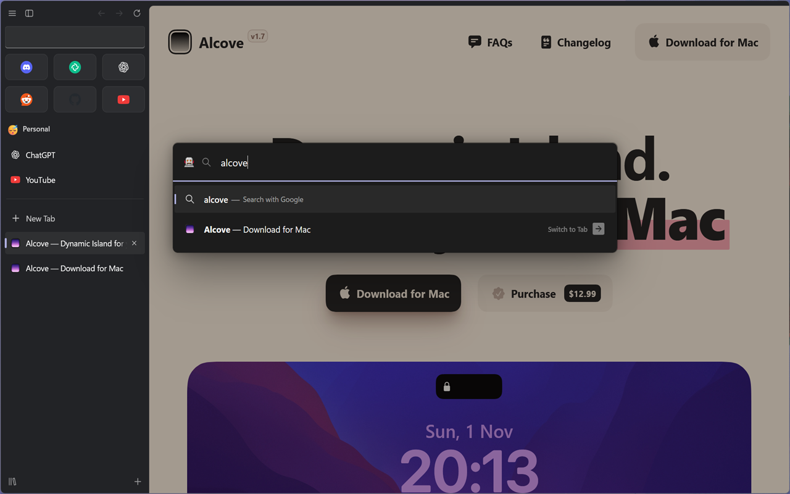 |
| **Mode compact**                                            | **Vue scindée**                            |
| 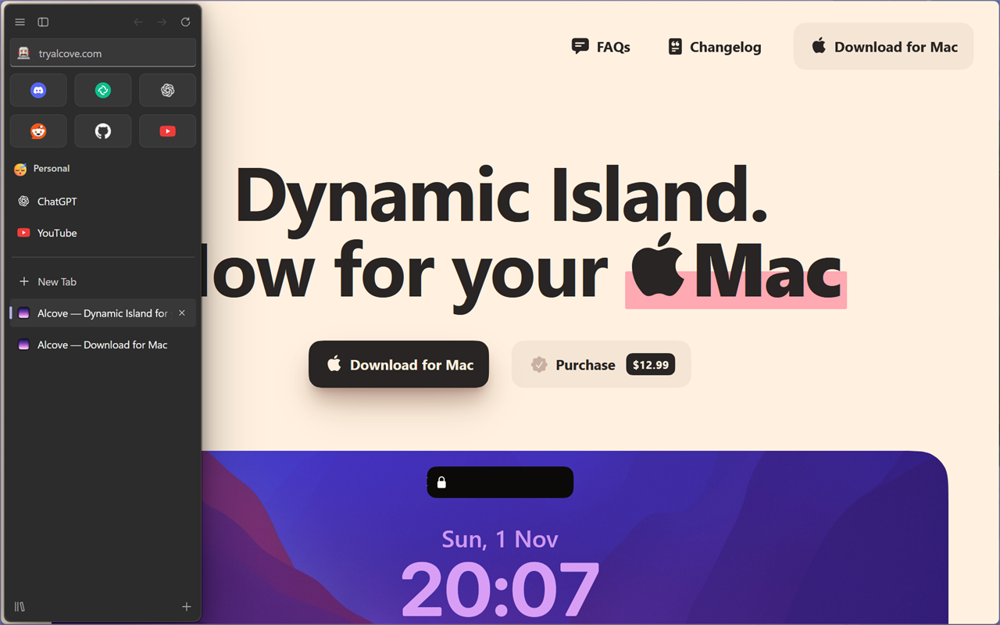                    | 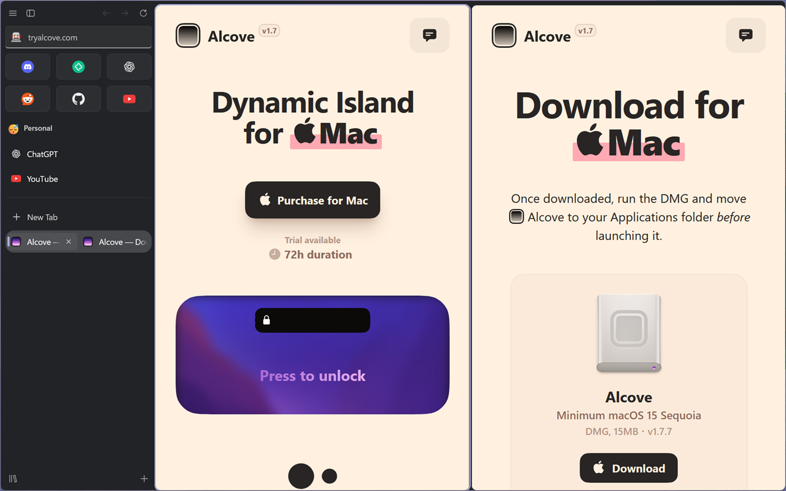      |
| **Glance**                                                  | **Bibliothèque**                           |
| 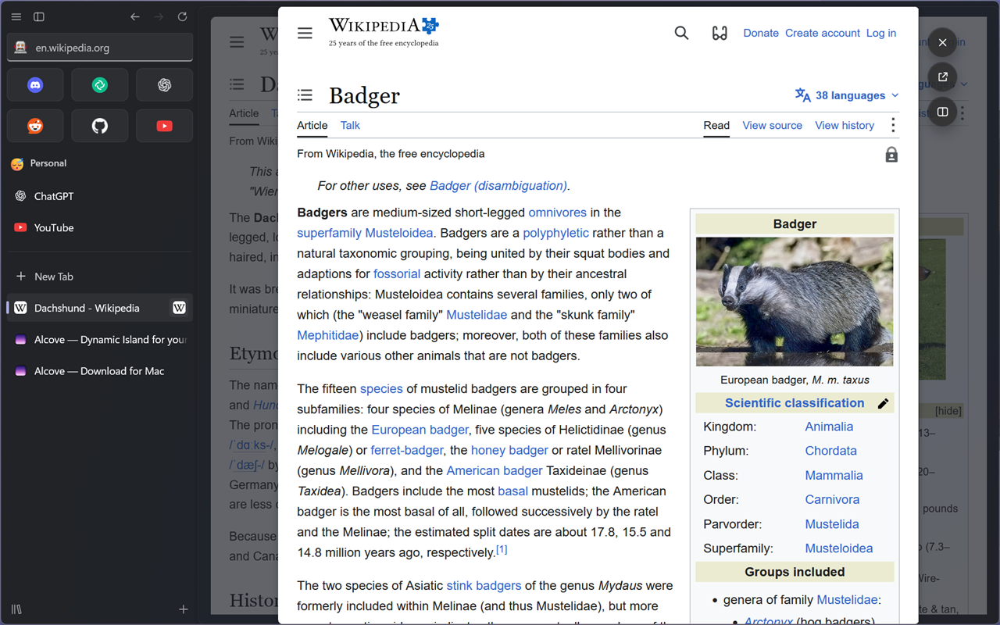                           | 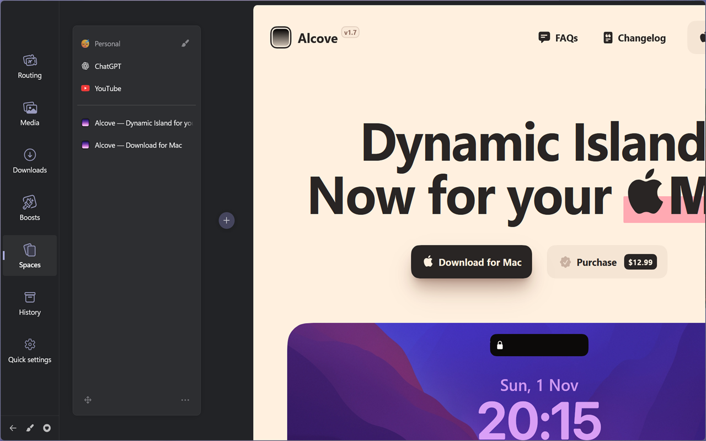   |
| **Plusieurs barres d'outils**                               | **Réglages dans Sine**                     |
| 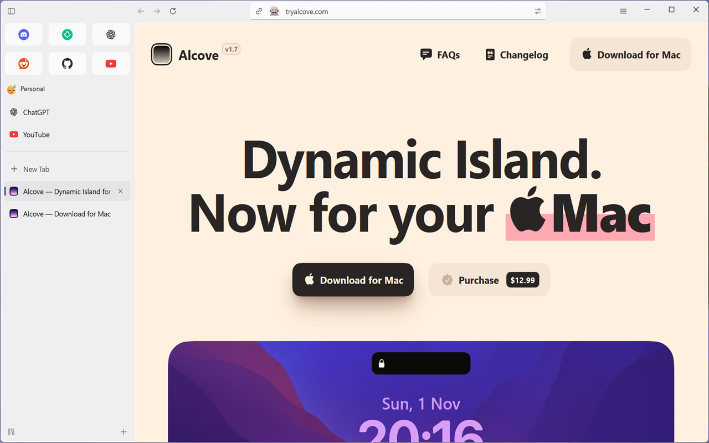 | 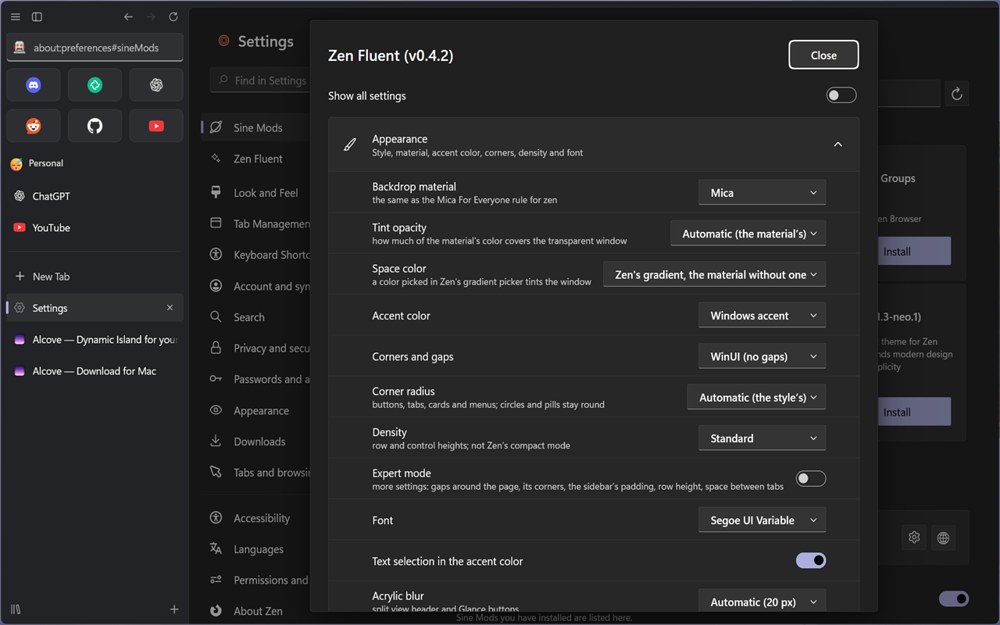  |

</details>

Windows 11 avec Mica For Everyone, Zen 1.24. Les pages sont celles du
[site de Zen](https://zen-browser.app), pour comparer avec l'apparence de
Zen.

## Installation

**Windows** : téléchargez `ZenFluentSetup.exe` depuis la
[dernière version](https://github.com/alexisdechiara/zen-fluent/releases/latest),
fermez Zen et lancez-le : il installe Sine, Zen Fluent et Zen Fluent Enhanced
([détails](installer/README.md), en anglais).

À la main, il vous faut Zen 1.23 ou plus récent et
[Sine](https://github.com/CosmoCreeper/Sine), le gestionnaire de mods de Zen
(téléchargez son installateur depuis
[ses versions](https://github.com/CosmoCreeper/Sine/releases), lancez-le,
redémarrez Zen).

1. Paramètres de Zen › **Sine Mods** › installer depuis GitHub :
   `alexisdechiara/zen-fluent`.
2. Cliquez sur la roue dentée de la carte de Zen Fluent et cochez **Allow the
   mod's icons** (pour les icônes Fluent).

**Windows 11** : le fond Mica / Acrylic translucide vient de
[Mica For Everyone](https://github.com/MicaForEveryone/MicaForEveryone), avec
une règle pour `zen` ; Zen Fluent le teinte.
**Linux et macOS** : Zen Fluent fonctionne aussi, avec le flou de votre
compositeur.

Pas à pas, Mica For Everyone, le flou sous Linux, une installation manuelle
sans Sine : [docs/fr/installation.md](docs/fr/installation.md).

## Zen Fluent Enhanced

Un second mod facultatif pour ce que le CSS ne peut pas faire. Chaque
fonction a son propre interrupteur ; celles qui changent le plus le
comportement de Zen sont désactivées au départ.

| Page de réglages                                   | Quick Settings                                    |
| -------------------------------------------------- | ------------------------------------------------- |
| 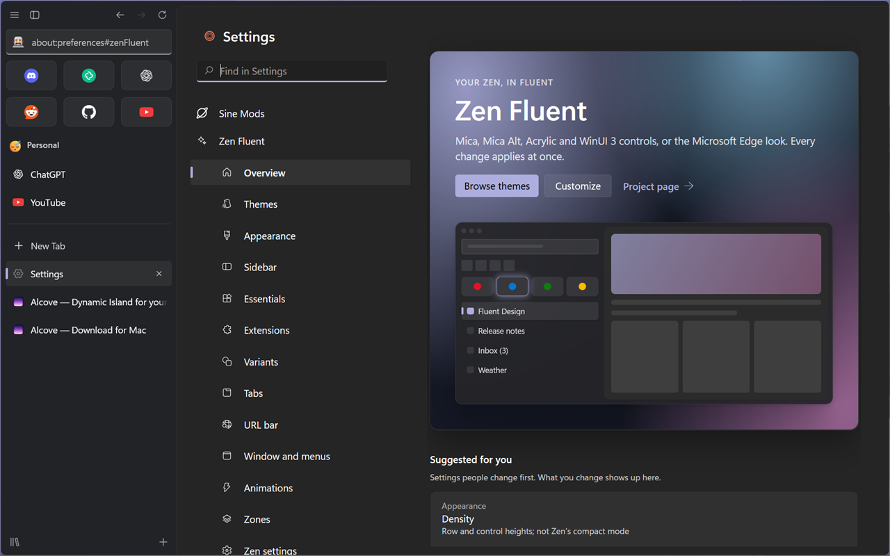 | 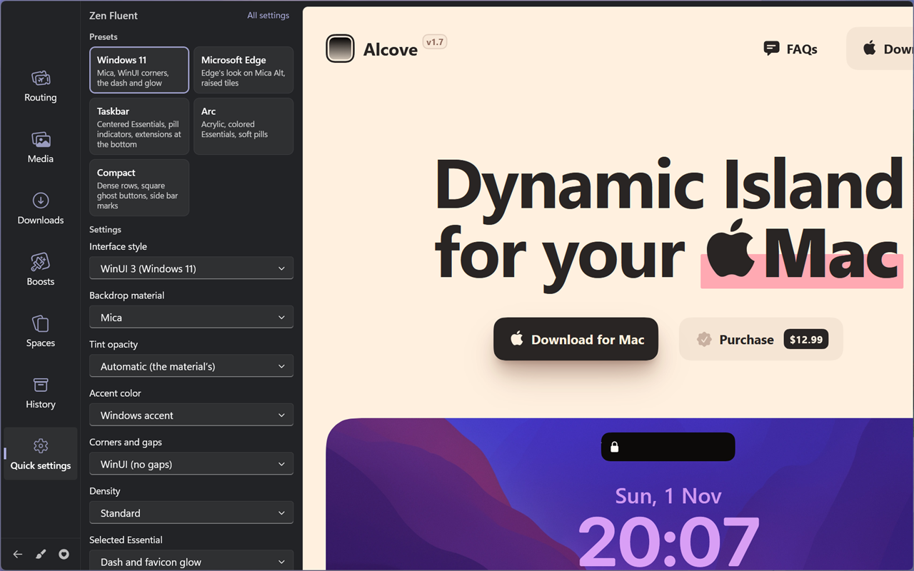 |

- **Une page de réglages** dans les paramètres de Zen, dans le style des
  Paramètres de Windows, avec des thèmes, l'import / export et une page de
  mods avec des badges de compatibilité.
- **Quick Settings** dans la Bibliothèque, avec des préréglages en un clic
  (Windows 11, Edge, Arc…).
- **Couleurs** : l'accent ou la teinte de la fenêtre suit le site où vous
  êtes, les dossiers reçoivent une couleur.
- **Onglets** : des cartes de survol avec un aperçu, Ctrl+Tab comme Alt+Tab,
  des numéros d'onglet, l'archivage et la mise en veille des onglets, des
  notes.
- **Productivité** : des dispositions d'ancrage pour la vue scindée, des
  sessions de concentration, une feuille des raccourcis clavier, des actions
  pour la palette de commandes, une page de démarrage, des widgets.

Installez-le comme Zen Fluent, depuis
`alexisdechiara/zen-fluent/tree/main/enhanced` (il installe Zen Fluent au
besoin). Sine n'exécute le JavaScript venu d'ailleurs que de sa boutique
qu'après avoir coché **Enable installing JS from unofficial sources** dans
les réglages de Sine. Chaque fonction :
[docs/fr/enhanced.md](docs/fr/enhanced.md).

## Réglages

Paramètres de Zen › Sine Mods › la roue dentée sur la carte de Zen Fluent (ou
la page de réglages d'Enhanced). Une page par groupe explique chaque
réglage :
[Appearance](docs/fr/settings/appearance.md),
[Sidebar](docs/fr/settings/sidebar.md),
[Essentials](docs/fr/settings/essentials.md),
[Extensions](docs/fr/settings/extensions.md),
[Variants](docs/fr/settings/variants.md),
[Tabs](docs/fr/settings/tabs.md),
[URL bar](docs/fr/settings/url-bar.md),
[Window and menus](docs/fr/settings/window-and-menus.md),
[Animations](docs/fr/settings/animations.md),
[Zones](docs/fr/settings/zones.md),
[Zen settings](docs/fr/settings/zen-settings.md). Chaque préférence avec sa
valeur par défaut : [docs/settings/README.md](docs/settings/README.md) (en
anglais).

## Autres mods

La plupart des mods fonctionnent à côté de Zen Fluent, certains grâce à des
règles de compatibilité qu'il inclut ; quelques-uns entrent en conflit avec
lui. La liste : [docs/fr/compatibility.md](docs/fr/compatibility.md).

## Contribuer

Les questions, les idées et les configurations vont dans les
[Discussions](https://github.com/alexisdechiara/zen-fluent/discussions), les
bugs et les mods en conflit dans les
[issues](https://github.com/alexisdechiara/zen-fluent/issues/new/choose),
en anglais de préférence. Envie d'aider ? Commencez par
[CONTRIBUTING.md](CONTRIBUTING.md) (en anglais) et les
[good first issues](https://github.com/alexisdechiara/zen-fluent/labels/good%20first%20issue).
Pour le code, l'organisation, les règles et les tests sont dans
[docs/fr/contributing.md](docs/fr/contributing.md) :

```sh
npm install
npm run lint       # prettier + stylelint
npm run check      # imports, réglages, docs, versions
```

## Politique de signature du code

`ZenFluentSetup.exe` n'est pas encore signé
([#15](https://github.com/alexisdechiara/zen-fluent/issues/15)) ; voici la
politique que suivra sa signature une fois le projet accepté par SignPath
Foundation.

- Signature de code gratuite fournie par [SignPath.io](https://signpath.io),
  certificat de [SignPath Foundation](https://signpath.org) (« Free code
  signing provided by SignPath.io, certificate by SignPath Foundation »).
- L'exe est construit depuis ce dépôt par son workflow GitHub
  ([installer.yml](.github/workflows/installer.yml)), jamais sur un
  ordinateur personnel, et chaque demande de signature est approuvée à la
  main.
- Auteurs et relecteurs :
  [les contributeurs du dépôt](https://github.com/alexisdechiara/zen-fluent/graphs/contributors),
  par des pull requests relues par le propriétaire.
- Approbateurs : [Alexis De Chiara](https://github.com/alexisdechiara),
  propriétaire du dépôt.

**Vie privée** : ce programme ne transfère aucune information vers d'autres
systèmes en réseau, sauf demande expresse de l'utilisateur ou de la personne
qui l'installe ou l'utilise. L'installateur télécharge ce que vous lui
demandez d'installer, depuis GitHub (Sine, son chargeur, Zen Fluent et Zen
Fluent Enhanced), et n'envoie rien d'autre. Les mods eux-mêmes ne font
aucune requête, sauf quand une fonction que vous activez le dit dans
[docs/fr/enhanced.md](docs/fr/enhanced.md) (parcourir, installer ou mettre à jour des
mods par Sine, ouvrir une page sur laquelle vous cliquez).

## Crédits

- [Firefox-WinUI](https://github.com/Lockframe/Firefox-WinUI) (Jhen, MIT) :
  jetons WinUI, accent, styles des boutons de la barre de titre, options de
  la barre d'adresse, des onglets, des menus et des animations ;
  [Edge-Frfox](https://github.com/bmFtZQ/edge-frfox) (MIT) pour deux options
  de menu. Leurs mentions : [THIRD-PARTY-NOTICES.md](THIRD-PARTY-NOTICES.md).
- [Arc 2.0](https://github.com/YashjitPal/Arc-2.0) (YashjitPal) : les
  extensions sous les Essentials, le fond de la barre latérale en mode
  compact.
- [Zia](https://github.com/z1n-k/zia) (z1nk) : la taille du texte des
  onglets, les réglages de Zen exposés dans le mod.
- Microsoft Edge et Fluent 2 : le style Edge (géométrie, couleurs, ombres).
- WinUI 3 et le Windows Community Toolkit : les contrôles, la ligne d'accent,
  les groupes SettingsExpander des réglages.

## Licence

[MIT](LICENSE)
