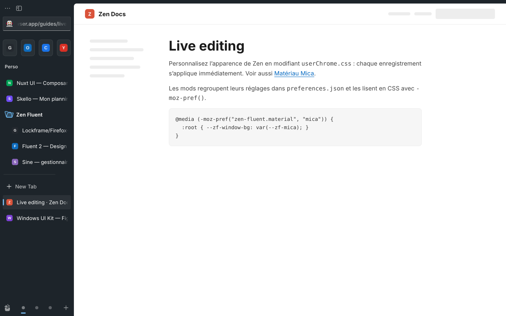
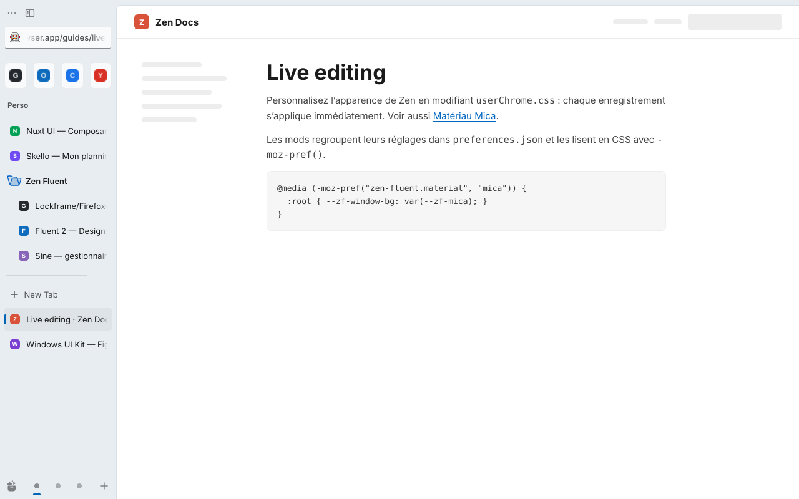
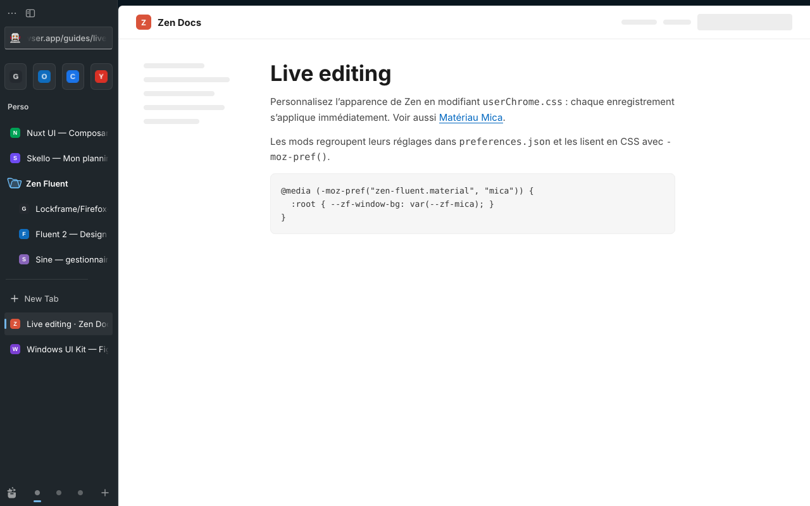
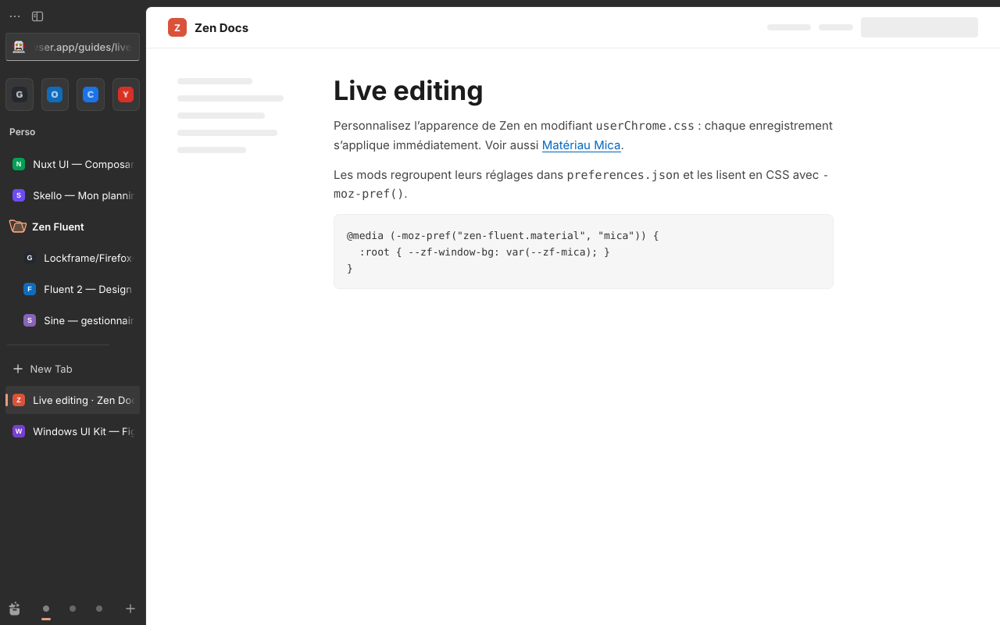
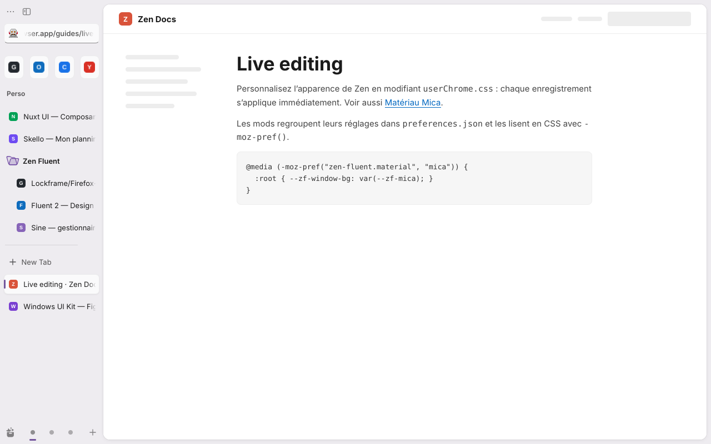
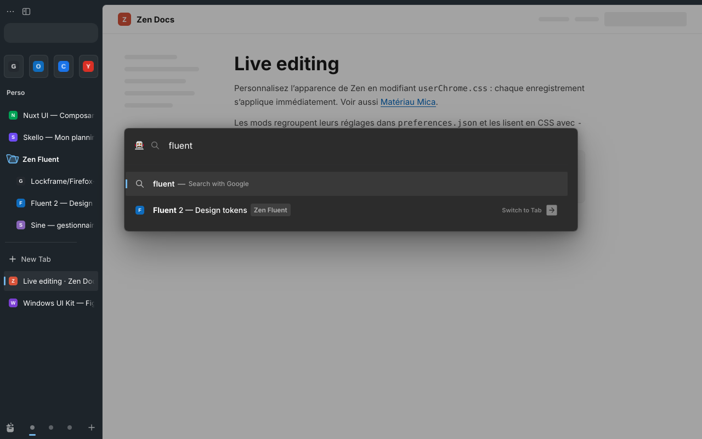
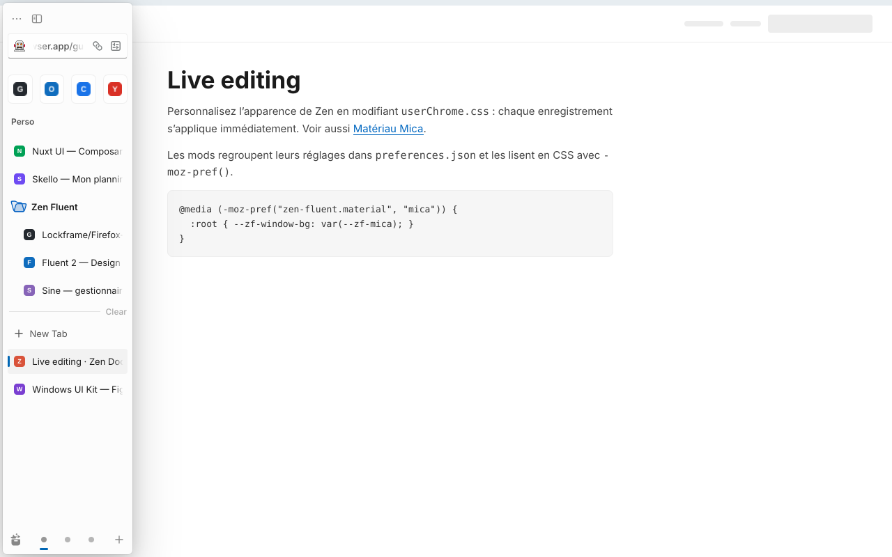
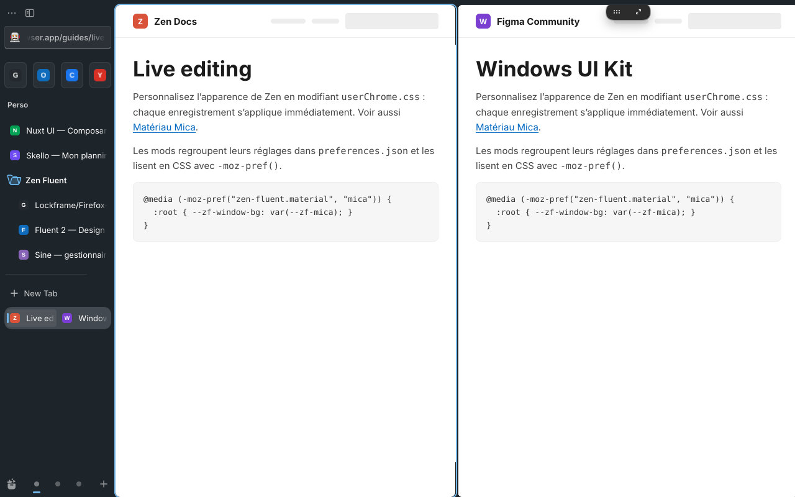
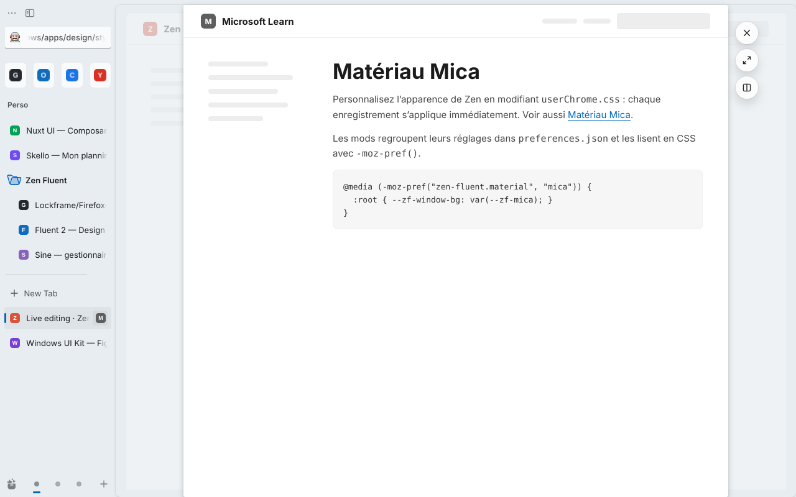
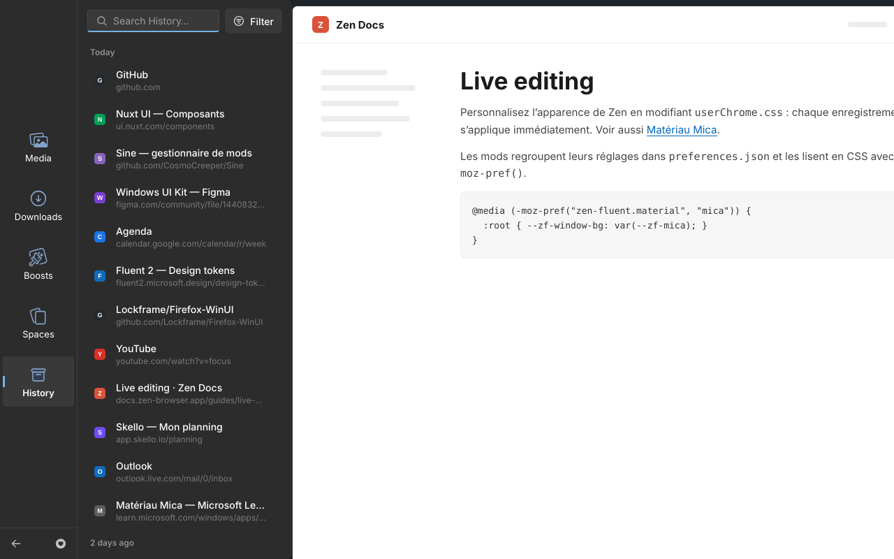

# Zen Fluent

Mica, Mica Alt, Acrylic et contrôles WinUI 3 pour [Zen Browser](https://zen-browser.app).
Le mod reprend les options de [Firefox-WinUI](https://github.com/Lockframe/Firefox-WinUI),
[Nebula](https://github.com/JustADumbPrsn/Zen-Nebula) et
[Arc 2.0](https://github.com/YashjitPal/Arc-2.0), et se règle depuis [Sine](https://github.com/CosmoCreeper/Sine).

Conçu pour Zen 1.23 : barre latérale verticale, Essentials, dossiers, vue scindée,
Glance, lecteur multimédia, Bibliothèque. Testé avec Zen 1.23.4b sous Linux
(le lecteur multimédia et les boutons de fenêtre Windows restent à vérifier).



## Aperçu

| Mica clair                                      | Mica Alt                                          |
| ----------------------------------------------- | ------------------------------------------------- |
|        |  |
| **Acrylic, accent orange**                      | **Angles Zen, accent violet**                     |
|  |  |
| **Barre d’adresse flottante**                   | **Mode compact, barre au survol**                 |
|       |           |
| **Vue scindée**                                 | **Glance**                                        |
|            |                  |
| **Bibliothèque**                                |                                                   |
|         |                                                   |

Captures prises sous Linux, sans flou du compositeur : sous Windows 11 avec
Mica For Everyone, le fond laisse transparaître le bureau.

## Installation

### Avec Sine

Paramètres › Sine › Mods : installer **Zen Fluent**, puis régler les options
dans la carte du mod. Sine écrit les valeurs par défaut de `preferences.json`.

### À la main

1. `about:config` : `toolkit.legacyUserProfileCustomizations.stylesheets` = `true`.
2. Copier `userChrome.css`, `userContent.css`, `modules/` et `icons/` dans le
   dossier `chrome/` du profil (`about:support` › Dossier du profil).
3. Créer les préférences `zen-fluent.*` du tableau ci-dessous dans `about:config`
   (sans Sine, une préférence absente vaut « désactivée »).
4. Redémarrer Zen.

### Windows 11 : Mica For Everyone

Le vrai fond Mica / Acrylic est appliqué par
[Mica For Everyone](https://github.com/MicaForEveryone/MicaForEveryone), comme
pour Nebula et Arc 2.0 ; Zen Fluent ne fait que le teinter.

1. Installer Mica For Everyone.
2. **Ajouter une règle** › **Règle de processus** : `zen`.
3. Choisir le type de fond identique à **Matériau de fond** dans Sine :

   | Matériau de fond (Sine) | Mica For Everyone |
   | ----------------------- | ----------------- |
   | Mica                    | Mica              |
   | Mica Alt (Tabbed)       | Tabbed            |
   | Acrylic                 | Acrylic           |

4. Paramètres Windows › Personnalisation › Couleurs : désactiver
   **Afficher la couleur d’accentuation sur les barres de titre et les bordures
   des fenêtres**, sinon la transparence ne s’affiche pas.
5. Laisser `widget.windows.mica` à `true` (valeur par défaut de Zen) : c’est ce
   qui garde la fenêtre transparente.

### Linux : transparence et flou du compositeur

Linux n’a pas de Mica : la fenêtre est rendue transparente par Zen et c’est le
compositeur qui floute ce qu’il y a derrière.

1. `about:config` : `zen.widget.linux.transparency` = `true`, puis redémarrer Zen.
   Zen Fluent passe alors des teintes pleines aux teintes translucides
   (Mica 40 %, Mica Alt 55 %, Acrylic 64 %).
2. Activer le flou selon le bureau :
   - **KDE Plasma** : installer
     [Better Blur DX](https://github.com/xarblu/kwin-effects-better-blur-dx),
     puis Paramètres › Fenêtres › Effets de bureau : désactiver **Flou**, activer
     **Better Blur DX**, et dans son onglet **Force blur** ajouter la classe `zen`
     (`zen-browser` pour le paquet AUR `zen-browser-bin`).
   - **GNOME** : extension [Blur my Shell](https://github.com/aunetx/blur-my-shell),
     onglet **Applications** : activer le flou des applications, désactiver
     **Opaque focused window**, opacité au maximum, ajouter `zen` à la liste.
   - **Hyprland** : `decoration { blur { enabled = true } }` dans `hyprland.conf` ;
     les fenêtres transparentes sont floutées.

Sans compositeur, la transparence donne un fond noir : laissez la préférence à
`false`, le mod peint alors le matériau en plein.

### Sans accélération matérielle

En rendu logiciel, Zen marque la fenêtre `zen-no-acrylic` et le flou CSS ne
fonctionne pas. Les surfaces Acrylic (menus, barre d’adresse, barre compacte,
Bibliothèque) prennent alors la couleur pleine de repli de WinUI, comme avec
« Réduire la transparence ».

Sur macOS, le mod teinte le fond transparent de la fenêtre.

## Réglages

| Groupe           | Réglage                                     | Préférence                        | Origine       |
| ---------------- | ------------------------------------------- | --------------------------------- | ------------- |
| Apparence        | Matériau de fond                            | `zen-fluent.material`             | Firefox-WinUI |
|                  | Couleur d’accent                            | `zen-fluent.accent`               | Zen Fluent    |
|                  | Angles et marges                            | `zen-fluent.corners`              | Nebula        |
|                  | Police Aptos                                | `zen-fluent.aptos`                | Firefox-WinUI |
| Barre latérale   | Extensions sous les Essentials              | `zen-fluent.pinned-extensions`    | Arc 2.0       |
|                  | Indicateur d’espace de travail              | `zen-fluent.workspace-indicator`  | Nebula        |
|                  | Style des icônes d’espace                   | `zen-fluent.workspace-style`      | Nebula        |
|                  | Icônes des Essentials en gris               | `zen-fluent.essentials-gray`      | Nebula        |
|                  | Fond Acrylic de la barre en mode compact    | `zen-fluent.compact-sidebar-bg`   | Arc 2.0       |
| Onglets          | Pastille d’accent sur l’onglet actif        | `zen-fluent.tab-pill`             | Zen Fluent    |
|                  | Ombre des onglets (angles Zen)              | `zen-fluent.tab-shadow`           | Nebula        |
|                  | Bouton de fermeture                         | `zen-fluent.tab-close-button`     | Firefox-WinUI |
|                  | Reflets sur l’onglet actif                  | `zen-fluent.extra-highlights`     | Firefox-WinUI |
| Barre d’adresse  | URL centrée                                 | `zen-fluent.url-centered`         | Firefox-WinUI |
|                  | Barre en pilule                             | `zen-fluent.url-pill`             | Firefox-WinUI |
|                  | Barre transparente                          | `zen-fluent.url-transparent`      | Firefox-WinUI |
| Fenêtre et menus | Boutons de fenêtre                          | `zen-fluent.titlebar-style`       | Firefox-WinUI |
|                  | Flèches façon macOS                         | `zen-fluent.mac-back-forward`     | Firefox-WinUI |
|                  | Masquer les raccourcis des menus            | `zen-fluent.hide-shortcuts`       | Firefox-WinUI |
| Animations       | Animation de changement d’onglet            | `zen-fluent.tab-switch-animation` | Nebula        |
|                  | Animation d’ouverture de la barre d’adresse | `zen-fluent.urlbar-animation`     | Nebula        |
|                  | Animations des boutons WinUI 3              | `zen-fluent.button-animations`    | Firefox-WinUI |

Valeurs des listes : voir `preferences.json`. Toutes les animations s’arrêtent
avec `prefers-reduced-motion`.

## Structure

```
zen-fluent/
├─ theme.json
├─ preferences.json
├─ userChrome.css        → @import des modules
├─ userContent.css       → nouvel onglet, pages internes
├─ icons/                → flèches WinUI et macOS, actualiser
└─ modules/
   ├─ tokens.css         → --zf-* sombre / clair, accent, rayons, police
   ├─ materials.css      → mica, mica-alt, acrylic, carte de contenu
   ├─ sidebar.css        → onglets, Essentials, dossiers, espaces
   ├─ extensions.css     → extensions épinglées
   ├─ urlbar.css         → barre flottante Acrylic
   ├─ split-glance.css   → vue scindée, Glance
   ├─ media.css          → lecteur, image incrustée
   ├─ library.css        → Bibliothèque (Zen 1.23)
   ├─ menus.css          → menus contextuels, panneaux
   ├─ window.css         → boutons de fenêtre, flèches
   ├─ animations.css     → transitions WinUI
   └─ content.css        → pages about:
```

Les couleurs sont des paires `light-dark()` : le mode clair ou sombre suit
`zen.view.window.scheme`. L’accent est dérivé avec `color-mix()` (+ 45 % de blanc
en sombre, + 15 % de noir en clair), comme dans Firefox-WinUI.

## Développement

Édition en direct : [guide Zen](https://docs.zen-browser.app/guides/live-editing)
(Ctrl+Maj+Alt+I › Éditeur de style).

```sh
npm install
npm run lint       # prettier + stylelint
npm run lint:fix
```

## Crédits

- [Firefox-WinUI](https://github.com/Lockframe/Firefox-WinUI) (Lockframe) : tokens WinUI,
  accent, styles de boutons de fenêtre, options de la barre d’adresse.
- [Nebula](https://github.com/JustADumbPrsn/Zen-Nebula) (JustADumbPrsn) : découpage en
  modules, options de la barre latérale et des animations.
- [Arc 2.0](https://github.com/YashjitPal/Arc-2.0) (YashjitPal) : extensions sous les
  Essentials, fond de la barre en mode compact.

## Licence

[MIT](LICENSE)
