# Zen Fluent

Make [Zen Browser](https://zen-browser.app) look like a Windows 11 app: Mica,
Mica Alt and Acrylic backgrounds, WinUI 3 controls, Fluent icons and
animations, or the Microsoft Edge look. Every detail can be changed from the
settings, nothing to edit by hand.

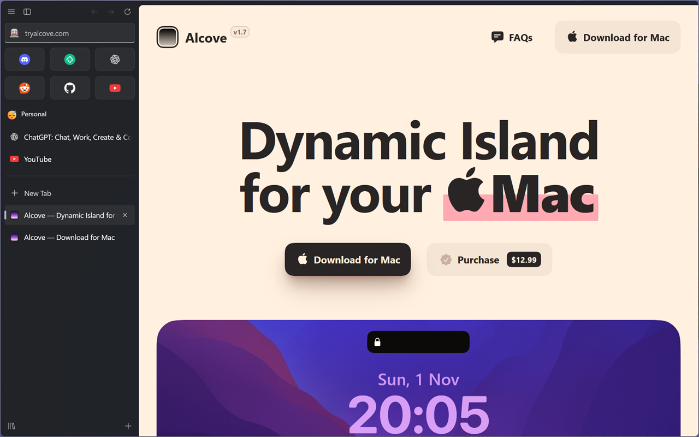

<p align="center">
  <a href="#install">Install</a> ·
  <a href="#gallery">Gallery</a> ·
  <a href="#zen-fluent-enhanced">Enhanced</a> ·
  <a href="docs/settings/README.md">Settings</a> ·
  <a href="docs/compatibility.md">Compatible mods</a> ·
  <a href="CHANGELOG.md">Changelog</a>
</p>

## What you get

- **The Windows 11 material** behind the sidebar and toolbars: Mica, Mica Alt
  or Acrylic, tinted with your space's color.
- **WinUI 3 controls everywhere**: tabs, Essentials, URL bar, menus, panels,
  dialogs, notifications, the Library, split view, Glance and Zen's own pages.
- **Two styles**: Windows 11 (WinUI) or Microsoft Edge (Fluent 2).
- **Your colors**: the Windows accent color, seven others or your own, light
  and dark mode, the corners and density you like.
- **More than a hundred settings** in collapsible groups. Each area (sidebar, URL
  bar, menus…) can also keep Zen's own look.
- **Accessible**: Windows contrast themes and reduced motion are followed.

Zen Fluent is pure CSS. **Zen Fluent Enhanced**, an optional second mod, adds
the features CSS cannot do (see [below](#zen-fluent-enhanced)).

## Gallery

| Light mode                                          | Microsoft Edge style                               |
| --------------------------------------------------- | -------------------------------------------------- |
| 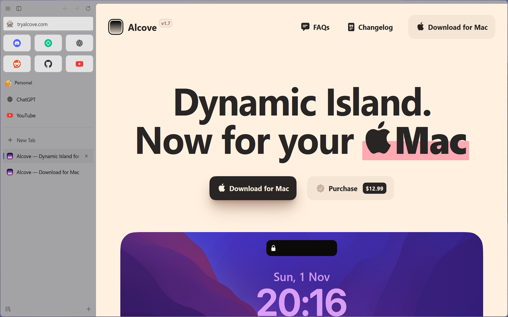 | 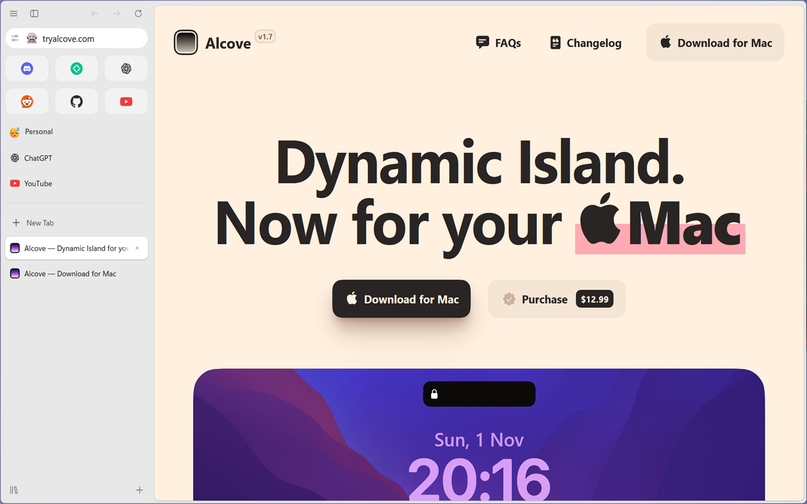                |
| **Acrylic, orange accent**                          | **Zen's corners, violet accent**                   |
|      | 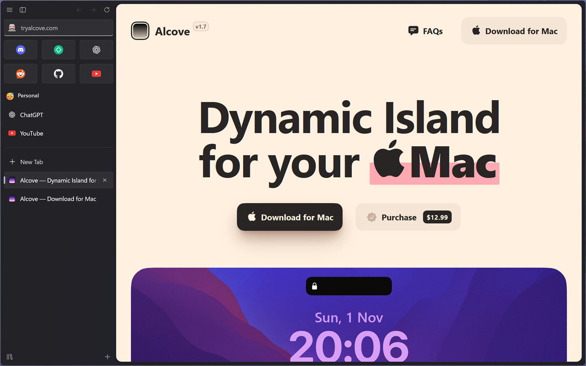 |

<details>
<summary>More screenshots</summary>

| Mica Alt                                            | Floating URL bar                       |
| --------------------------------------------------- | -------------------------------------- |
| 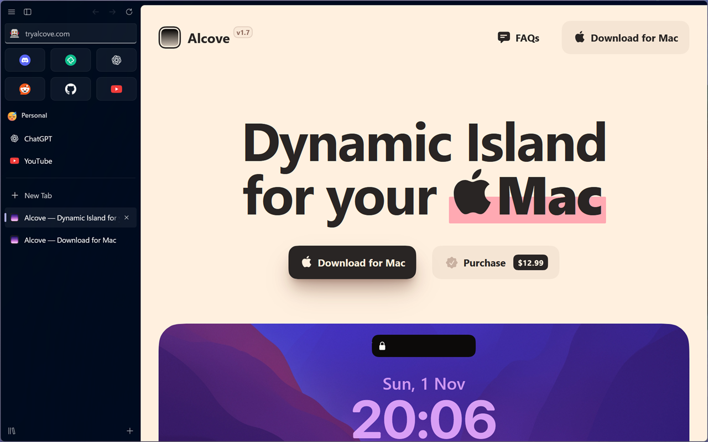          | 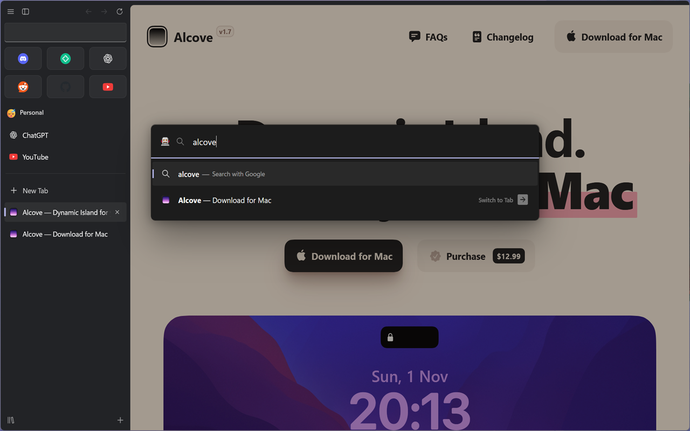     |
| **Compact mode**                                    | **Split view**                         |
| 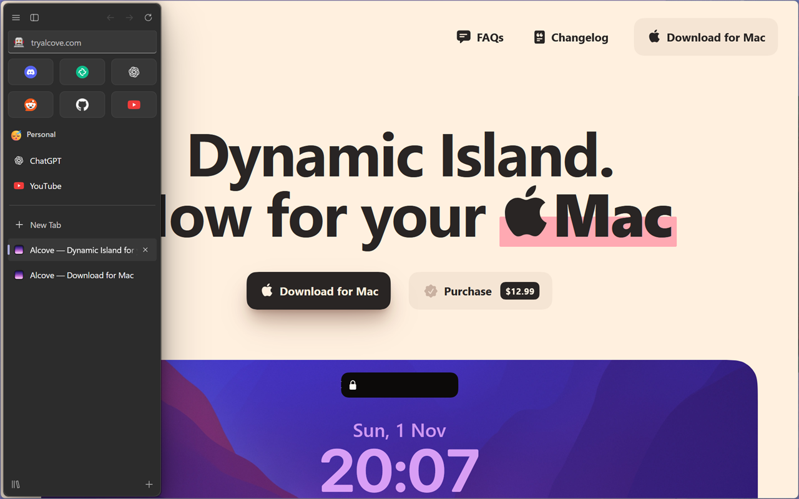            | 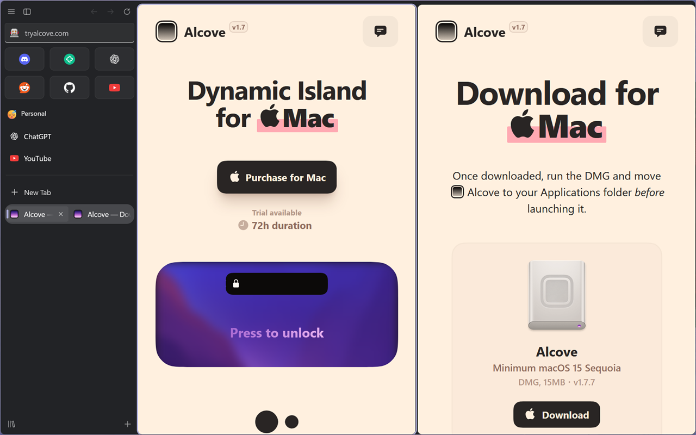   |
| **Glance**                                          | **Library**                            |
| 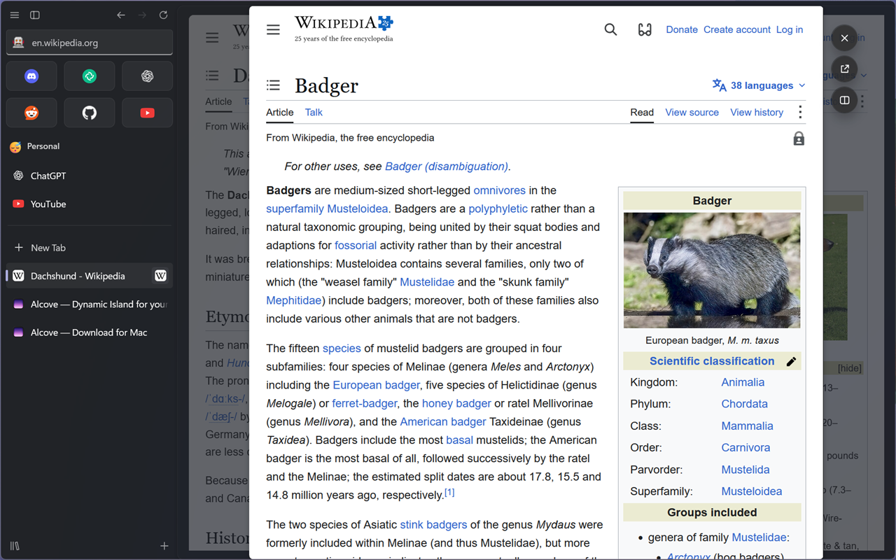                   | 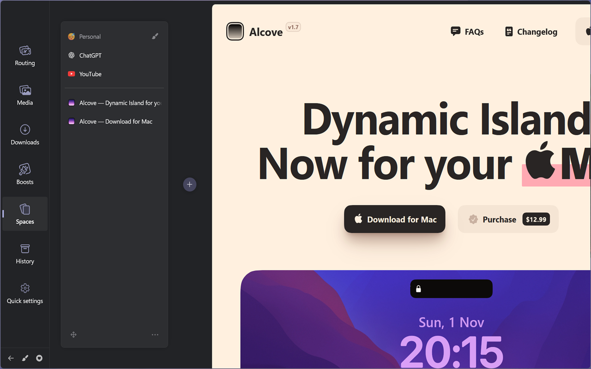    |
| **Multiple toolbars**                               | **Settings in Sine**                   |
| 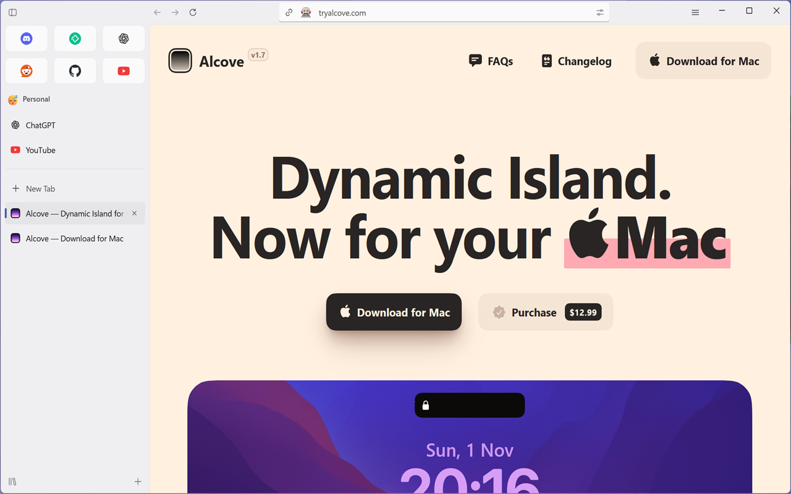 | 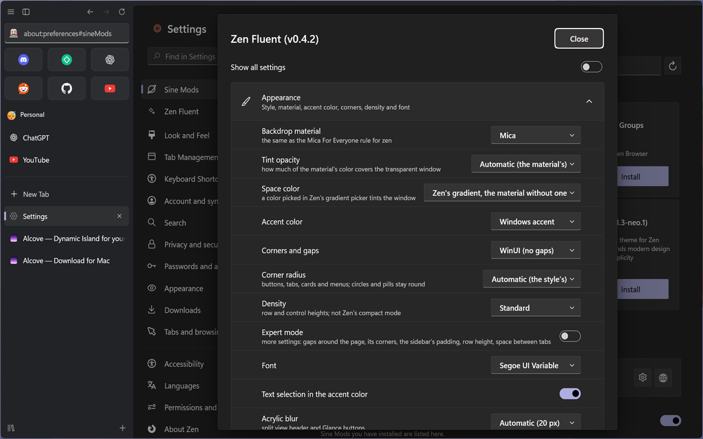 |

</details>

Windows 11 with Mica For Everyone, Zen 1.24. The pages are the ones of
[Zen's website](https://zen-browser.app), to compare with Zen's own look.

## Install

**Windows**: download `ZenFluentSetup.exe` from the
[latest release](https://github.com/alexisdechiara/zen-fluent/releases/latest),
close Zen and run it: it installs Sine, Zen Fluent and Zen Fluent Enhanced
([details](installer/README.md)).

By hand, you need Zen 1.23 or later and [Sine](https://github.com/CosmoCreeper/Sine),
Zen's mod manager (download its installer from
[its releases](https://github.com/CosmoCreeper/Sine/releases), run it, restart
Zen).

1. Zen settings › **Sine Mods** › install from GitHub:
   `alexisdechiara/zen-fluent`.
2. Click the gear on Zen Fluent's card and check **Allow the mod's icons**
   (for the Fluent icons).

**Windows 11**: the see-through Mica / Acrylic background comes from
[Mica For Everyone](https://github.com/MicaForEveryone/MicaForEveryone), with a
rule for `zen`; Zen Fluent tints it.
**Linux and macOS**: Zen Fluent works too, with your compositor's blur.

Step by step, Mica For Everyone, Linux blur, a manual install without Sine:
[docs/installation.md](docs/installation.md)
([en français](docs/fr/installation.md)).

## Zen Fluent Enhanced

An optional second mod for what CSS cannot do. Each feature has its own
switch; the ones that change how Zen behaves the most start off.

| Settings page                                   | Quick Settings                                    |
| ----------------------------------------------- | ------------------------------------------------- |
| 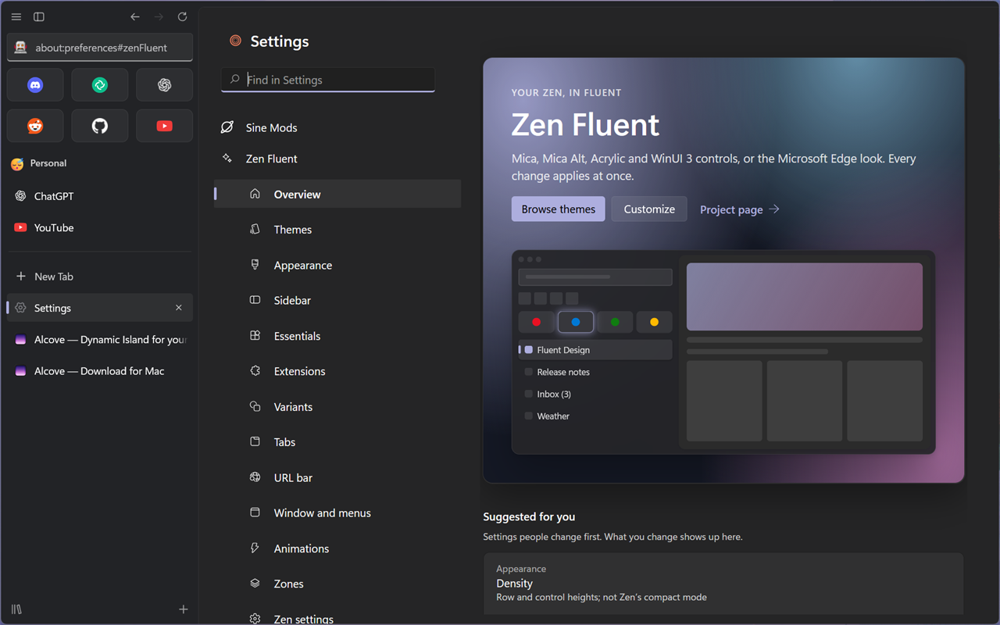 | 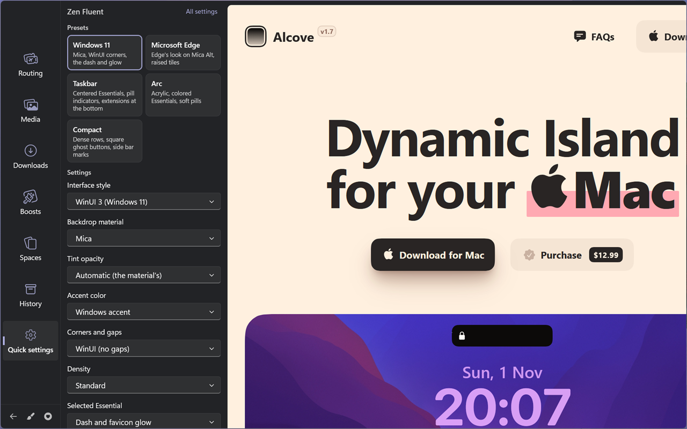 |

- **A settings page** in Zen's settings, in the style of Windows Settings, with
  themes, import / export and a mods page with compatibility badges.
- **Quick Settings** in the Library, with one-click presets (Windows 11, Edge,
  Arc…).
- **Colors**: the accent or the window tint follows the site you are on,
  folders get a color.
- **Tabs**: hover cards with a preview, Ctrl+Tab like Alt+Tab, tab numbers,
  archiving and sleeping tabs, notes.
- **Productivity**: snap layouts for split view, focus sessions, a keyboard
  shortcuts sheet, Command Palette actions, a start page, widgets.

Install it like Zen Fluent, from `alexisdechiara/zen-fluent/tree/main/enhanced`
(it installs Zen Fluent if needed). Sine runs JavaScript from outside its store
only after you check **Enable installing JS from unofficial sources** in Sine's
settings. Every feature: [docs/enhanced.md](docs/enhanced.md).

## Settings

Zen settings › Sine Mods › gear on Zen Fluent's card (or the settings page of
Enhanced). One page per group explains each setting:
[Appearance](docs/settings/appearance.md),
[Sidebar](docs/settings/sidebar.md),
[Essentials](docs/settings/essentials.md),
[Extensions](docs/settings/extensions.md),
[Variants](docs/settings/variants.md), [Tabs](docs/settings/tabs.md),
[URL bar](docs/settings/url-bar.md),
[Window and menus](docs/settings/window-and-menus.md),
[Animations](docs/settings/animations.md), [Zones](docs/settings/zones.md),
[Zen settings](docs/settings/zen-settings.md). Every preference with its
default: [docs/settings/README.md](docs/settings/README.md).

## Other mods

Most mods work alongside Zen Fluent, some thanks to compat rules it includes; a
few conflict with it. The list: [docs/compatibility.md](docs/compatibility.md).

## Contributing

Questions, ideas and setups go to
[Discussions](https://github.com/alexisdechiara/zen-fluent/discussions), bugs
and clashing mods to the
[issues](https://github.com/alexisdechiara/zen-fluent/issues/new/choose).
Want to help? Start with [CONTRIBUTING.md](CONTRIBUTING.md) and the
[good first issues](https://github.com/alexisdechiara/zen-fluent/labels/good%20first%20issue).
For code, the layout, rules and tests are in
[docs/contributing.md](docs/contributing.md):

```sh
npm install
npm run lint       # prettier + stylelint
npm run check      # imports, settings, docs, versions
```

## Credits

- [Firefox-WinUI](https://github.com/Lockframe/Firefox-WinUI) (Jhen, MIT): WinUI
  tokens, accent, caption button styles, URL bar, tab, menu and animation
  options; [Edge-Frfox](https://github.com/bmFtZQ/edge-frfox) (MIT) for two menu
  options. Their notices: [THIRD-PARTY-NOTICES.md](THIRD-PARTY-NOTICES.md).
- [Arc 2.0](https://github.com/YashjitPal/Arc-2.0) (YashjitPal): extensions under
  the Essentials, compact mode sidebar background.
- [Zia](https://github.com/z1n-k/zia) (z1nk): tab text size, Zen settings
  exposed in the mod.
- Microsoft Edge and Fluent 2: the Edge style (geometry, colors, shadows).
- WinUI 3 and the Windows Community Toolkit: controls, accent line, the
  SettingsExpander groups of the settings.

## Licence

[MIT](LICENSE)
