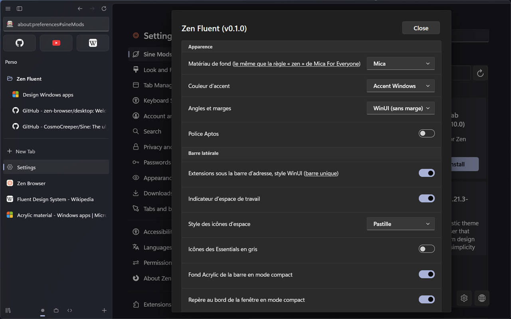
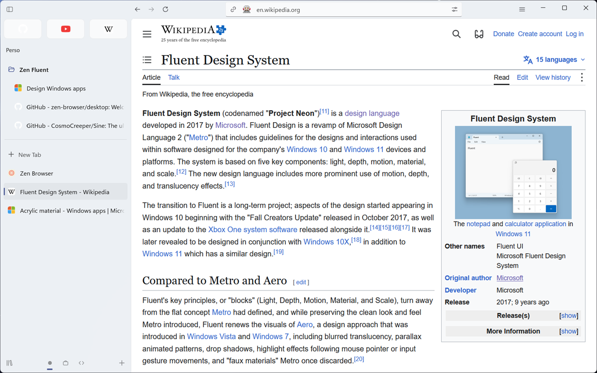

# Zen Fluent

Mica, Mica Alt, Acrylic and WinUI 3 controls for
[Zen Browser](https://zen-browser.app), or the Microsoft Edge look (Fluent 2).
Everything is set from [Sine](https://github.com/CosmoCreeper/Sine), with no
JavaScript.

Built for Zen 1.23: vertical sidebar, Essentials, folders, split view, Glance,
media card, Library. Tested with Zen 1.23.4b on Linux and on Windows 11 with
Mica For Everyone.


## Preview

| Light Mica                                          | Mica Alt                                           |
| --------------------------------------------------- | -------------------------------------------------- |
|            |     |
| **Acrylic, orange accent**                          | **Zen corners, violet accent**                     |
|      |  |
| **Floating URL bar**                                | **Compact mode, sidebar on hover**                 |
|                   |            |
| **Split view**                                      | **Glance**                                         |
|                 |                   |
| **Library**                                         | **The mod's settings in Sine**                     |
|                  |              |
| **Multiple toolbars, light Mica**                   |                                                    |
|  |                                                    |

Screenshots taken on Windows 11 with Mica For Everyone (Zen 1.23.4b, 1280 × 800
window): the Mica and Acrylic backdrop shows the desktop through.

## Two mods

- **Zen Fluent** (`core/`): CSS only. Install it with Sine, nothing else to set
  up.
- **Zen Fluent Enhanced** (`enhanced/`): a JavaScript layer on top of Zen
  Fluent, one script per feature, each one can be turned off: see
  [docs/enhanced.md](docs/enhanced.md).

## Install

1. Install [Sine](https://github.com/CosmoCreeper/Sine).
2. Zen settings › Sine › Mods, install from GitHub:
   `alexisdechiara/zen-fluent`.
3. Open the mod's settings (gear on its card) and check **Allow the mod's
   icons** for the Fluent icons.

On Windows 11, the Mica / Acrylic backdrop comes from
[Mica For Everyone](https://github.com/MicaForEveryone/MicaForEveryone) (a rule
for `zen`); Zen Fluent tints it. Linux transparency, macOS, a manual install
without Sine and the details: [docs/installation.md](docs/installation.md).

Other mods: some need Zen Fluent’s compat rules (included), a few conflict
with it: see [docs/compatibility.md](docs/compatibility.md).

## Settings

Every setting, its preference and its default. Values and notes: one page per
group in [docs/settings/](docs/settings/).

| Group                                                 | Setting                                          | Preference                                                                  | Default            |
| ----------------------------------------------------- | ------------------------------------------------ | --------------------------------------------------------------------------- | ------------------ |
| [Appearance](docs/settings/appearance.md)             | Interface style                                  | `zen-fluent.style`                                                          | `winui`            |
|                                                       | Backdrop material                                | `zen-fluent.material`                                                       | `mica`             |
|                                                       | Tint opacity                                     | `zen-fluent.tint-opacity`                                                   | `auto`             |
|                                                       | Custom opacity                                   | `zen-fluent.tint-opacity-custom`                                            | `64%`              |
|                                                       | Accent color                                     | `zen-fluent.accent`                                                         | `system`           |
|                                                       | Custom color                                     | `zen-fluent.accent-custom`                                                  | `#0078d4`          |
|                                                       | Corners and gaps                                 | `zen-fluent.corners`                                                        | `winui`            |
|                                                       | Corner radius                                    | `zen-fluent.corner-radius`                                                  | `auto`             |
|                                                       | Custom radius                                    | `zen-fluent.corner-radius-custom`                                           | `6px`              |
|                                                       | Density                                          | `zen-fluent.density`                                                        | `standard`         |
|                                                       | Font                                             | `zen-fluent.font`                                                           | `segoe`            |
|                                                       | Custom font                                      | `zen-fluent.font-custom`                                                    | `(empty)`          |
|                                                       | Text selection in the accent color               | `zen-fluent.accent-selection`                                               | `true`             |
|                                                       | Acrylic blur                                     | `zen-fluent.acrylic-blur`                                                   | `auto`             |
|                                                       | Custom blur                                      | `zen-fluent.acrylic-blur-custom`                                            | `20px`             |
|                                                       | Acrylic noise                                    | `zen-fluent.acrylic-noise`                                                  | `false`            |
| [Sidebar](docs/settings/sidebar.md)                   | Button style                                     | `zen-fluent.button-style`                                                   | `subtle`           |
|                                                       | Hide the Forward button when it is disabled      | `zen-fluent.hide-forward-disabled`                                          | `false`            |
|                                                       | Workspace indicator                              | `zen-fluent.workspace-indicator`                                            | `true`             |
|                                                       | Workspace icon style                             | `zen-fluent.workspace-style`                                                | `pill`             |
|                                                       | Acrylic sidebar background in compact mode       | `zen-fluent.compact-sidebar-bg`                                             | `true`             |
|                                                       | Edge hint at the window border in compact mode   | `zen-fluent.compact-edge-hint`                                              | `true`             |
| [Essentials](docs/settings/essentials.md)             | Selected Essential                               | `zen-fluent.essentials.selected-style`                                      | `glow`             |
|                                                       | Selected Essential color                         | `zen-fluent.essentials.selected-color`                                      | `accent`           |
|                                                       | Open page indicator                              | `zen-fluent.essentials.running`                                             | `none`             |
|                                                       | Hover                                            | `zen-fluent.essentials.hover`                                               | `fill`             |
|                                                       | Labels                                           | `zen-fluent.essentials.labels`                                              | `hide`             |
|                                                       | Essentials per row                               | `zen-fluent.essentials-per-row`                                             | `auto`             |
|                                                       | Essentials width                                 | `zen-fluent.essentials.width`                                               | `auto`             |
|                                                       | Icon size                                        | `zen-fluent.essentials.icon-size`                                           | `medium`           |
|                                                       | Essentials height                                | `zen-fluent.essentials.height`                                              | `auto`             |
|                                                       | Space between Essentials                         | `zen-fluent.essentials.gap`                                                 | `auto`             |
|                                                       | Alignment                                        | `zen-fluent.essentials.align`                                               | `start`            |
|                                                       | Grey Essentials icons                            | `zen-fluent.essentials-gray`                                                | `false`            |
| [Extensions](docs/settings/extensions.md)             | WinUI style for the extensions row               | `zen-fluent.pinned-extensions`                                              | `true`             |
|                                                       | Place                                            | `zen-fluent.extensions.position`                                            | `top`              |
|                                                       | Columns                                          | `zen-fluent.extensions.columns`                                             | `auto`             |
|                                                       | Rows                                             | `zen-fluent.extensions.rows`                                                | `auto`             |
|                                                       | Icon size                                        | `zen-fluent.extensions.icon-size`                                           | `auto`             |
|                                                       | Button size                                      | `zen-fluent.extensions.button-size`                                         | `auto`             |
|                                                       | Space between buttons                            | `zen-fluent.extensions.gap`                                                 | `auto`             |
|                                                       | Alignment                                        | `zen-fluent.extensions.align`                                               | `auto`             |
|                                                       | Row background                                   | `zen-fluent.extensions.background`                                          | `none`             |
|                                                       | Badges                                           | `zen-fluent.extensions.badge`                                               | `show`             |
| [Variants](docs/settings/variants.md)                 | Fill, everywhere                                 | `zen-fluent.variant.global`                                                 | `auto`             |
|                                                       | Shape, everywhere                                | `zen-fluent.variant.global-shape`                                           | `auto`             |
|                                                       | Toolbar and sidebar buttons: fill                | `zen-fluent.variant.buttons`                                                | `auto`             |
|                                                       | Toolbar and sidebar buttons: shape               | `zen-fluent.variant.buttons-shape`                                          | `auto`             |
|                                                       | Extension buttons: fill                          | `zen-fluent.variant.extensions`                                             | `auto`             |
|                                                       | Extension buttons: shape                         | `zen-fluent.variant.extensions-shape`                                       | `auto`             |
|                                                       | Essentials: fill                                 | `zen-fluent.variant.essentials`                                             | `auto`             |
|                                                       | Essentials: shape                                | `zen-fluent.variant.essentials-shape`                                       | `auto`             |
|                                                       | Tabs: fill                                       | `zen-fluent.variant.tabs`                                                   | `auto`             |
|                                                       | Tabs: shape                                      | `zen-fluent.variant.tabs-shape`                                             | `auto`             |
|                                                       | Pinned tabs: fill                                | `zen-fluent.variant.pinned-tabs`                                            | `auto`             |
|                                                       | Pinned tabs: shape                               | `zen-fluent.variant.pinned-tabs-shape`                                      | `auto`             |
|                                                       | Folder headers: fill                             | `zen-fluent.variant.folders`                                                | `auto`             |
|                                                       | Folder headers: shape                            | `zen-fluent.variant.folders-shape`                                          | `auto`             |
|                                                       | Space buttons: fill                              | `zen-fluent.variant.spaces`                                                 | `auto`             |
|                                                       | Space buttons: shape                             | `zen-fluent.variant.spaces-shape`                                           | `auto`             |
|                                                       | URL bar: fill                                    | `zen-fluent.variant.urlbar`                                                 | `auto`             |
|                                                       | URL bar: shape                                   | `zen-fluent.variant.urlbar-shape`                                           | `auto`             |
|                                                       | URL bar buttons: fill                            | `zen-fluent.variant.urlbar-buttons`                                         | `auto`             |
|                                                       | URL bar buttons: shape                           | `zen-fluent.variant.urlbar-buttons-shape`                                   | `auto`             |
|                                                       | Badges: fill                                     | `zen-fluent.variant.badges`                                                 | `auto`             |
|                                                       | Badges: shape                                    | `zen-fluent.variant.badges-shape`                                           | `auto`             |
|                                                       | Panel and dialog buttons: fill                   | `zen-fluent.variant.panel-buttons`                                          | `auto`             |
|                                                       | Panel and dialog buttons: shape                  | `zen-fluent.variant.panel-buttons-shape`                                    | `auto`             |
| [Tabs](docs/settings/tabs.md)                         | Tab text size                                    | `zen-fluent.tab-text-size`                                                  | `normal`           |
|                                                       | Bold title on the selected tab                   | `zen-fluent.tab-bold`                                                       | `false`            |
|                                                       | Accent pill on the selected tab                  | `zen-fluent.tab-pill`                                                       | `true`             |
|                                                       | Tab shadow                                       | `zen-fluent.tab-shadow`                                                     | `true`             |
|                                                       | Tab close button                                 | `zen-fluent.tab-close-button`                                               | `1`                |
|                                                       | Close button in the collapsed sidebar            | `zen-fluent.collapsed-tab-close`                                            | `default`          |
|                                                       | Highlights on the selected tab, menus and panels | `zen-fluent.extra-highlights`                                               | `false`            |
|                                                       | Dim unloaded tabs                                | `zen-fluent.dim-unloaded-tabs`                                              | `true`             |
|                                                       | Animated sound bars on playing tabs              | `zen-fluent.sound-bars`                                                     | `true`             |
|                                                       | Container tabs                                   | `zen-fluent.container-tabs`                                                 | `line`             |
|                                                       | “Drag tabs here” in empty folders                | `zen-fluent.empty-folder-hint`                                              | `true`             |
| [URL bar](docs/settings/url-bar.md)                   | URL bar shape                                    | `zen-fluent.url-style`                                                      | `auto`             |
|                                                       | Accent line under the URL bar                    | `zen-fluent.url-underline`                                                  | `focus`            |
|                                                       | Centered URL                                     | `zen-fluent.url-centered`                                                   | `false`            |
|                                                       | Hide the zoom level                              | `zen-fluent.url-hide-zoom`                                                  | `false`            |
|                                                       | Hide permission icons                            | `zen-fluent.url-hide-permissions`                                           | `false`            |
| [Window and menus](docs/settings/window-and-menus.md) | Caption buttons                                  | `zen-fluent.titlebar-style`                                                 | `windows11`        |
|                                                       | Auto-hide the bookmarks toolbar                  | `zen-fluent.bookmarks-autohide`                                             | `false`            |
|                                                       | Page loading bar                                 | `zen-fluent.loading-bar`                                                    | `winui`            |
|                                                       | macOS-style arrows                               | `zen-fluent.mac-back-forward`                                               | `false`            |
|                                                       | Back / Forward in the context menu               | `zen-fluent.context-navigation`                                             | `icons`            |
|                                                       | Hide menu shortcuts                              | `zen-fluent.hide-shortcuts`                                                 | `false`            |
|                                                       | Hide underlined letters in menus                 | `zen-fluent.hide-access-keys`                                               | `false`            |
|                                                       | Thin scrollbars in web pages                     | `zen-fluent.thin-scrollbars-web`                                            | `false`            |
| [Animations](docs/settings/animations.md)             | Tab switch animation                             | `zen-fluent.tab-switch-animation`                                           | `fluent`           |
|                                                       | URL bar opening animation                        | `zen-fluent.urlbar-animation`                                               | `fade`             |
|                                                       | Menu animation                                   | `zen-fluent.menu-animation`                                                 | `flyout`           |
|                                                       | WinUI 3 button animations                        | `zen-fluent.button-animations`                                              | `true`             |
|                                                       | Back / Forward arrow bounce                      | `zen-fluent.nav-bounce`                                                     | `false`            |
|                                                       | Animated icons                                   | `zen-fluent.animated-icons`                                                 | `true`             |
| [Zones](docs/settings/zones.md)                       | Window                                           | `zen-fluent.fluent-window`                                                  | `true`             |
|                                                       | Sidebar                                          | `zen-fluent.fluent-sidebar`                                                 | `true`             |
|                                                       | URL bar                                          | `zen-fluent.fluent-urlbar`                                                  | `true`             |
|                                                       | Menus and panels                                 | `zen-fluent.fluent-menus`                                                   | `true`             |
|                                                       | Notifications                                    | `zen-fluent.fluent-notifications`                                           | `true`             |
|                                                       | Find bar                                         | `zen-fluent.fluent-findbar`                                                 | `true`             |
|                                                       | Library                                          | `zen-fluent.fluent-library`                                                 | `true`             |
|                                                       | Media                                            | `zen-fluent.fluent-media`                                                   | `true`             |
|                                                       | Split view and Glance                            | `zen-fluent.fluent-split-glance`                                            | `true`             |
|                                                       | Dialogs                                          | `zen-fluent.fluent-dialogs`                                                 | `true`             |
|                                                       | Firefox sidebar                                  | `zen-fluent.fluent-firefox-sidebar`                                         | `true`             |
|                                                       | Zen screens                                      | `zen-fluent.fluent-screens`                                                 | `true`             |
|                                                       | Fluent icons                                     | `zen-fluent.fluent-icons`                                                   | `true`             |
|                                                       | Allow the mod's icons                            | `svg.context-properties.content.enabled`                                    | `true`             |
|                                                       | Settings and internal pages                      | `zen-fluent.fluent-content`                                                 | `true`             |
| [Zen settings](docs/settings/zen-settings.md)         | Floating URL bar                                 | `zen.urlbar.behavior`                                                       | `floating-on-type` |
|                                                       | New tab in the floating URL bar                  | `zen.urlbar.replace-newtab`                                                 | `true`             |
|                                                       | Copy link button                                 | `zen.urlbar.single-toolbar-show-copy-url`                                   | `true`             |
|                                                       | Domain only in the URL bar                       | `zen.urlbar.show-domain-only-in-sidebar`                                    | `true`             |
|                                                       | Tracking protection icon                         | `zen.urlbar.show-protections-icon`                                          | `false`            |
|                                                       | Picture-in-Picture button in the URL bar         | `zen.urlbar.show-pip-button`                                                | `false`            |
|                                                       | Tab preview on hover                             | `browser.tabs.hoverPreview.enabled`                                         | `false`            |
|                                                       | Page thumbnail in the preview                    | `browser.tabs.hoverPreview.showThumbnails`                                  | `true`             |
|                                                       | Page loading indicator                           | `zen.view.enable-loading-indicator`                                         | `true`             |
|                                                       | Grey out inactive windows                        | `zen.view.grey-out-inactive-windows`                                        | `true`             |
|                                                       | Drop a tab on the page to split the view         | `zen.splitView.enable-tab-drop`                                             | `true`             |
|                                                       | Picture-in-Picture when leaving a video's tab    | `media.videocontrols.picture-in-picture.enable-when-switching-tabs.enabled` | `false`            |
|                                                       | Full Picture-in-Picture controls                 | `media.videocontrols.picture-in-picture.improved-video-controls.enabled`    | `true`             |

The `zen-fluent.ui.open-<group>` checkboxes are the group headers (open or
closed; only **Appearance** is open by default) and `zen-fluent.ui.expand-all`
(**Show all settings**, default `false`) opens every group.

Zen Fluent Enhanced has its own settings, one checkbox per feature
([docs/enhanced.md](docs/enhanced.md)):

| Feature                         | Preference                                        | Default |
| ------------------------------- | ------------------------------------------------- | ------- |
| Quick Settings                  | `zen-fluent.enhanced.quick-settings`              | `true`  |
| Icon colors                     | `zen-fluent.enhanced.favicon-color`               | `true`  |
| Adaptive accent                 | `zen-fluent.enhanced.adaptive-accent`             | `false` |
| Extensions under the Essentials | `zen-fluent.enhanced.extensions-below-essentials` | `false` |
| Tab numbers while Ctrl is held  | `zen-fluent.enhanced.tab-numbers`                 | `true`  |
| Shortcuts                       | `zen-fluent.enhanced.shortcuts`                   | `true`  |

## Repository

```
theme.json        Zen Fluent's Sine manifest, points into core/
core/             Zen Fluent: chrome.css, userContent.css, preferences.json, icons/, src/
enhanced/         Zen Fluent Enhanced: theme.json, chrome.css, scripts/
components.json   manifest for the future installer
docs/             installation, settings, compatibility, Enhanced, contributing
```

## Development

Live editing: [Zen's guide](https://docs.zen-browser.app/guides/live-editing)
(Ctrl+Shift+Alt+I › Style Editor). Rules, layout and tests:
[docs/contributing.md](docs/contributing.md). Changes:
[CHANGELOG.md](CHANGELOG.md).

```sh
npm install
npm run lint       # prettier + stylelint
npm run check      # imports, settings, docs, versions
```

## Credits

- [Firefox-WinUI](https://github.com/Lockframe/Firefox-WinUI) (Jhen, MIT): WinUI
  tokens, accent, caption button styles, URL bar, tab, menu and animation
  options; [Edge-Frfox](https://github.com/bmFtZQ/edge-frfox) (MIT) for two menu
  options. Their notices: [THIRD-PARTY-NOTICES.md](THIRD-PARTY-NOTICES.md).
- [Arc 2.0](https://github.com/YashjitPal/Arc-2.0) (YashjitPal): extensions under
  the Essentials, compact mode sidebar background.
- [Zia](https://github.com/z1n-k/zia) (z1nk): tab text size, Zen settings
  exposed in the mod.
- Microsoft Edge and Fluent 2: the Edge style (geometry, colors, shadows).
- WinUI 3 and the Windows Community Toolkit: controls, accent line, the
  SettingsExpander groups of the settings.

## Licence

[MIT](LICENSE)
